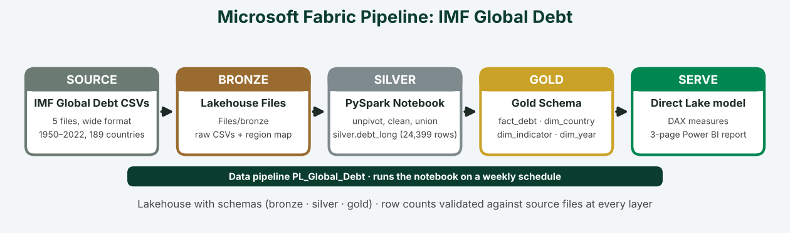
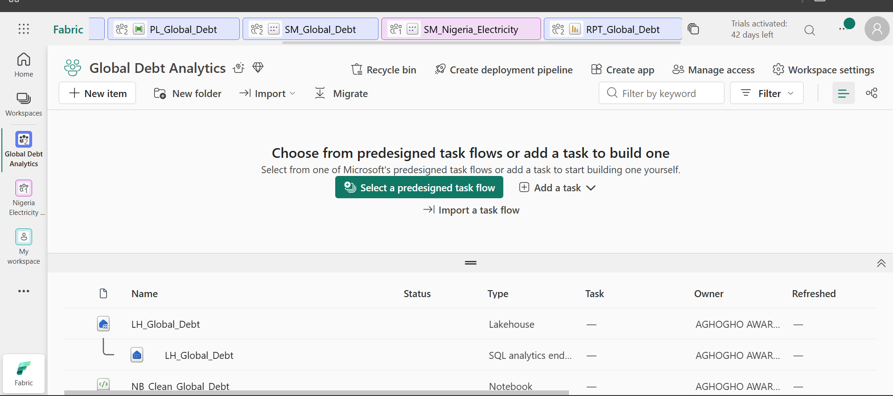
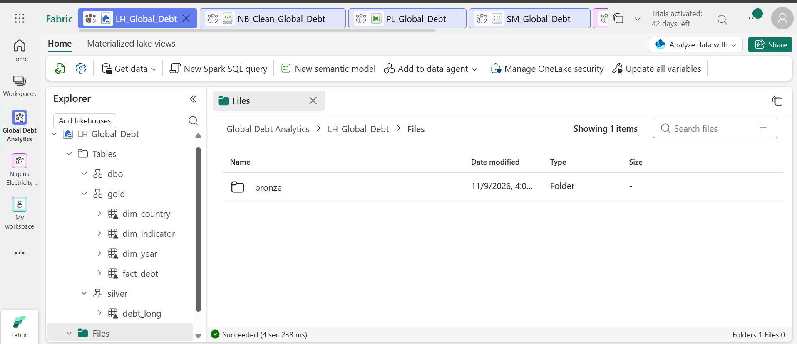
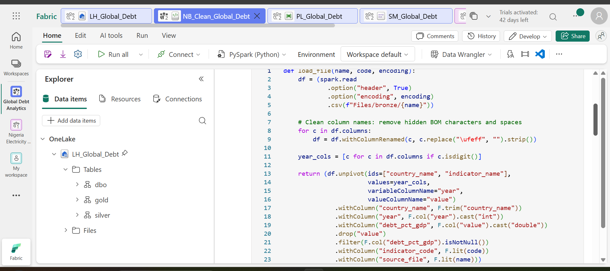
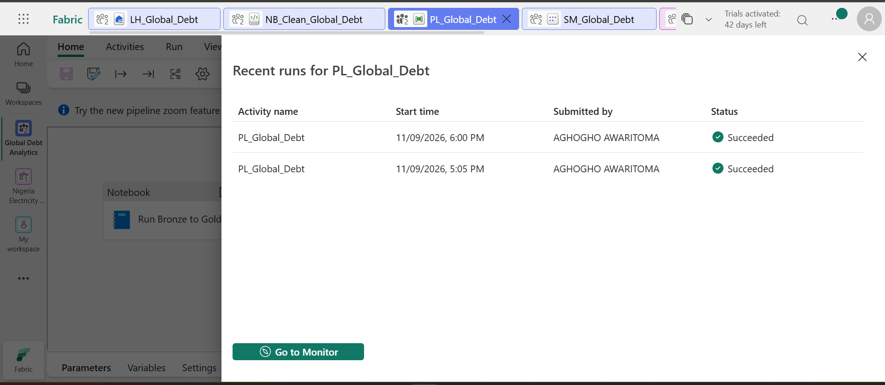
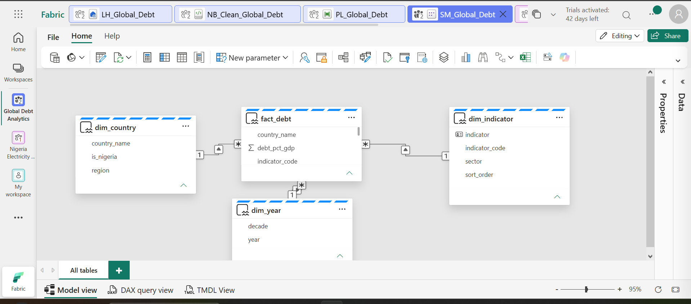
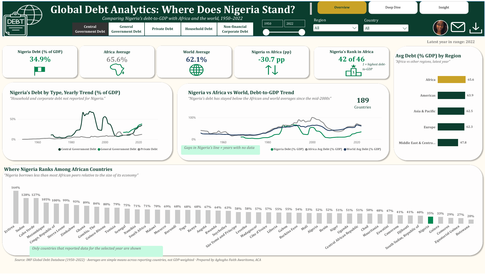
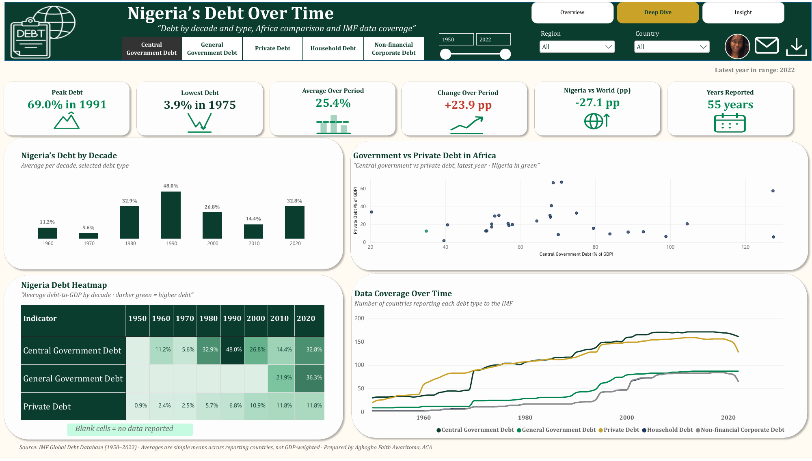
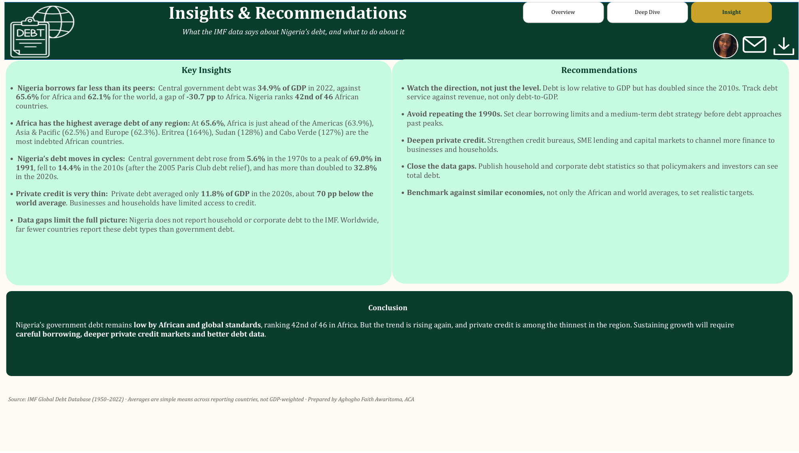

# Global Debt Analytics: Where Does Nigeria Stand? (Microsoft Fabric)

An end-to-end **Microsoft Fabric** project that turns five raw IMF debt files into a **medallion lakehouse** (Bronze → Silver → Gold), cleaned with a **PySpark notebook**, orchestrated by a **scheduled data pipeline**, and served through a **Direct Lake** semantic model and a 3-page Power BI report.

The report compares Nigeria's debt-to-GDP with Africa and the world from **1950 to 2022**, across **189 countries** and **5 types of debt**.

This is my second Fabric project, following my [Nigerian Electricity Data Pipeline](https://github.com/Aghogho-data/nigeria-electricity-fabric-pipeline). Where that project used Dataflow Gen2, this one uses **PySpark notebooks, lakehouse schemas and pipeline orchestration**, applying the skills from my **Microsoft Certified: Fabric Analytics Engineer Associate (DP-600)** certification.



---

## 📌 Questions answered

1. How does Nigeria's debt compare with the African and world averages?
2. Where does Nigeria rank among African countries?
3. How has Nigeria's debt changed by decade and by type of debt?
4. Which regions carry the most debt?
5. How complete is the data, and where are the gaps?

## 🛠️ Fabric items and skills

| Item | Name | Purpose |
|---|---|---|
| **Workspace** (Fabric trial capacity) | Global Debt Analytics | Holds all project items |
| **Lakehouse** (schemas enabled) | LH_Global_Debt | `Files/bronze` for raw files; `silver` and `gold` schemas for Delta tables |
| **Notebook** (PySpark) | NB_Clean_Global_Debt | Reads, unpivots, cleans, validates and models the data |
| **Data pipeline** | PL_Global_Debt | Runs the notebook on a weekly schedule, with failure alerts |
| **Semantic model** (Direct Lake) | SM_Global_Debt | Star schema, relationships and DAX measures |
| **Power BI report** | RPT_Global_Debt | 3 pages: Overview, Deep Dive, Insights & Recommendations |

**Skills shown:** OneLake, lakehouse schemas, medallion architecture, PySpark (unpivot, union, joins, Delta tables), data validation, pipeline orchestration and scheduling, star schema modelling, Direct Lake, DAX (time intelligence, ranking, dynamic text, conditional formatting), report design and data storytelling.



---

## 🥉 Bronze: raw files

The five IMF CSVs are uploaded unchanged to `Files/bronze`, together with a reference file, `country_region.csv`, that maps each of the 189 countries to one of 5 regions:

| Region | Countries |
|---|---|
| Africa | 53 |
| Europe | 42 |
| Asia & Pacific | 36 |
| Americas | 34 |
| Middle East & Central Asia | 24 |



## 🥈 Silver: PySpark notebook



Each source file is in **wide format**, with one column per year. The notebook:

1. Reads each CSV with the correct **encoding** (four files are ISO-8859-1, one is UTF-8, so country names such as *Côte d'Ivoire* and *Türkiye* display correctly).
2. Removes hidden characters from the headers.
3. **Unpivots** the year columns into `year` and `debt_pct_gdp` rows.
4. Trims country names, sets data types and drops empty values.
5. Tags each row with an indicator code (CGD, GGD, HHD, NFC, PVD).
6. **Unions** the five files into one table, `silver.debt_long`.

```python
silver = reduce(lambda a, b: a.unionByName(b), parts)
silver.write.mode("overwrite").format("delta").saveAsTable("silver.debt_long")
```

## 🥇 Gold: star schema

| Table | Rows | Description |
|---|---|---|
| `gold.fact_debt` | 24,399 | Country, indicator, year and debt as % of GDP |
| `gold.dim_country` | 189 | Country, region and a Nigeria flag |
| `gold.dim_indicator` | 5 | Debt type, public/private sector and sort order |
| `gold.dim_year` | 73 | Years 1950–2022 and decade |

## ⚙️ Orchestration: data pipeline



`PL_Global_Debt` runs the notebook with a **Notebook activity** on a **weekly schedule** (Mondays, 06:00 WAT), with an email alert on failure. A full run takes about 1.5 minutes.

## 🔷 Serve: Direct Lake semantic model



One-to-many relationships from the three dimensions to `fact_debt`, with single-direction filtering. Key DAX measures:

| Measure | Logic |
|---|---|
| Avg Debt (% GDP) | Average across countries; returns blank unless one debt type is selected, so different debt types are never mixed |
| Nigeria / Africa / World averages | `CALCULATE` with country or region filters and `REMOVEFILTERS` |
| … Latest | The value for the **end year of the year slider**, so cards show one year rather than a 73-year average |
| Nigeria vs Africa / World (pp) | The gap in percentage points, **blank when either side has no data** |
| Nigeria Africa Rank | Ranks Nigeria among African countries **that reported data** for that year, e.g. "42 of 46" |
| Peak / Lowest Debt | The highest and lowest value with its year, e.g. "69.0% in 1991" |
| Countries Reporting | Distinct countries with data, to show coverage |
| Colour measures | Highlight Nigeria in green and set readable text colours in the heatmap |

---

## 📊 Report

### Page 1: Overview


### Page 2: Deep Dive


### Page 3: Insights & Recommendations


**Interactivity:** debt-type tiles, a year range slider, region and country filters, page navigation buttons, a reset button, and links to my LinkedIn and portfolio.

---

## 💡 Key insights *(Central Government Debt, 2022)*

- **Nigeria borrows far less than its peers.** Central government debt was **34.9% of GDP**, against **65.6%** for Africa and **62.1%** for the world. Nigeria ranks **42nd of 46** African countries.
- **Africa has the highest average debt of any region** (65.6%), just ahead of the Americas (63.9%). Eritrea (164%), Sudan (128%) and Cabo Verde (127%) are the most indebted African countries.
- **Nigeria's debt moves in cycles.** It peaked at **69.0% in 1991**, fell to a **14.4%** average in the 2010s (after the 2005 Paris Club debt relief), and has more than doubled to **32.8%** in the 2020s.
- **Private credit is very thin.** Private debt averaged **11.8% of GDP** in the 2020s, about **70 percentage points below the world average**.
- **There are data gaps.** Nigeria does not report household or corporate debt to the IMF, and far fewer countries worldwide report these debt types.

## ✅ Recommendations

1. **Watch the direction, not just the level:** track debt service against revenue, not only debt-to-GDP.
2. **Avoid repeating the 1990s:** set borrowing limits and a medium-term debt strategy.
3. **Deepen private credit** through credit bureaus, SME lending and capital markets.
4. **Close the data gaps** by publishing household and corporate debt statistics.
5. **Benchmark against similar economies,** not only regional and world averages.

---

## 🔍 Data validation and quality

| Check | Result |
|---|---|
| Rows per debt type in Silver vs source files | ✅ Matched: CGD 8,116 · GGD 3,281 · HHD 2,493 · NFC 2,480 · PVD 8,029 (total 24,399) |
| Countries without a region | ✅ 0 of 189 |
| Gold table counts | ✅ 189 countries · 5 indicators · 73 years · 24,399 facts |
| Accented country names | ✅ Display correctly after fixing file encodings |
| DAX results | ✅ Checked in DAX query view before building the report |

**Issues found and fixed:**

| Issue | Fix |
|---|---|
| Spark rejected the `windows-1252` encoding | Used the equivalent `iso-8859-1` |
| The Nigeria vs Africa gap showed a value when Nigeria had **no data** (DAX treats blank as 0) | Returned blank unless both values exist |
| Cards averaged all 73 years in the slider range | Added "latest year" measures |
| Few countries report General Government Debt, leaving the scatter chart with only 4 points | Switched the comparison to Central Government Debt, which has much wider coverage |

**Method notes:** averages are **simple means across reporting countries**, not GDP-weighted, so they differ from the IMF's headline global figures. The number of reporting countries varies by year and debt type.

## 📚 Data source

[IMF Global Debt Database](https://www.imf.org/external/datamapper/datasets/GDD): debt as a percentage of GDP for central government, general government, household, non-financial corporate and private debt, 1950–2022.

## 📁 Repository contents

| File | Description |
|---|---|
| `0-pipeline-diagram.png` | Architecture overview |
| `1-workspace.png` | Fabric workspace items |
| `2-lakehouse.png` | Lakehouse files and schemas |
| `3-notebook.png` | PySpark notebook |
| `4-pipeline.png` | Data pipeline run and schedule |
| `5-semantic-model.png` | Direct Lake model relationships |
| `6-report-overview.png`, `7-report-deep-dive.png`, `8-report-insights.png` | Report pages |
| `RPT_Global_Debt.pdf` | Full report as PDF |
| `NB_Clean_Global_Debt.ipynb` | The PySpark notebook |
| `country_region.csv` | Country-to-region mapping |

---

## 👩🏾‍💻 Author

**Aghogho Faith Awaritoma, ACA**, Chartered Accountant & Data Analyst · Microsoft Certified: Power BI Data Analyst & Fabric Analytics Engineer

🔗 [Portfolio](https://aghogho-data.github.io) · [LinkedIn](https://www.linkedin.com/in/awaritomafaith) · [GitHub](https://github.com/Aghogho-data)
---
© 2026 Aghogho Faith Awaritoma. All rights reserved.
